# BIT 2118 Scientific Computing  Group Work Documentation (Tasks 2–20)

Prerequisite / Task 01: Data Science Essentials with Python
Before tackling the numerical computation modules, I completed the self-paced foundation course Data Science Essentials with Python.
Course Status: Completed
Course Title: Data Science Essentials with Python
Certificate / Proof of Completion: https://www.credly.com/badges/844a3555-0824-4517-bd3c-689b6652a671/public_url
## Task 02: NumPy Arrays and Numerical Computation

### B. Inputs and Mathematical Operations
- **Inputs:** A 1D array `temperatures_c` of 24 hourly temperature readings in Celsius.
- **Math operations:**
  - Mean $\mu = \frac{1}{N}\sum x_i$ with `np.mean()`; extremes with `np.min()` and `np.max()`.
  - Vectorized conversion $F = 1.8C + 32$ applied to the whole array in one expression without a loop.

### C. Parameter Variation Experiment
- **What I changed:** Added $5^\circ\text{C}$ to every reading to simulate a heat wave.
- **What happened:**
  - Mean rose from $23.12^\circ\text{C}$ to $28.12^\circ\text{C}$; minimum rose from $17.50^\circ\text{C}$ to $22.50^\circ\text{C}$; maximum rose from $29.40^\circ\text{C}$ to $34.40^\circ\text{C}$.
  - The range ($\max - \min = 11.9^\circ\text{C}$) did not change.
- **Why it changed:** Adding a constant $c$ shifts the mean by $c$ ($\mu' = \mu + c$) and moves every value equally, so spread measures such as the range stay the same.

### D. Output Interpretation
- The mean temperature was **$23.12^\circ\text{C}$**, a warm day.
- The coldest reading was **$17.50^\circ\text{C}$** in the early morning and the hottest was **$29.40^\circ\text{C}$** in the early afternoon.
- The first six Fahrenheit values `[65.3, 64.4, 64.04, 63.5, 64.22, 66.2]` confirm the formula was applied element by element.

### E. Real-World Adaptation: IoT Soil-Moisture Sensor
- **Script Location:** `adaptations/Task_02_adapted.py`
- **Real-world Problem:** Convert raw ADC readings of a soil sensor into moisture percentages and decide when irrigation is needed.
- **Assumptions:**
  - Raw value 850 is completely dry, 350 is fully wet, and the response is linear.
  - Irrigate when moisture is below 30%.
  - Formula:
  $$\text{moisture}\% = \frac{850 - \text{raw}}{850 - 350} \times 100$$
- **New Inputs:** 12 raw ADC readings from `820` down to `500`.
- **Results & Findings:**
  - Moisture rose from **6%** to **70%**, with a mean of **46.1%**.
  - **3 of 12** readings were below the 30% threshold.
- **Takeaway:** The soil starts dry and gets wetter over the period due to rain or irrigation. One vectorized formula calibrates every reading at once.

---

## Task 03: Mathematical Functions and Vectorization

### B. Inputs and Mathematical Operations
- **Inputs:** 1,000,000 simulated latencies `latency_ms` drawn uniformly from 5 to 250 ms with `default_rng(42)`.
- **Math operations:**
  - Scaling $s = \frac{ms}{1000}$, then squaring $s^2$.
  - Done two ways: a Python `for` loop and a single NumPy expression, timed with `timeit`.

### C. Parameter Variation Experiment
- **What I changed:** The sample size $N$ was changed to `10,000` and `5,000,000` instead of `1,000,000`.
- **What happened:** On my run the speed-up stayed between **$45\times$ and $60\times$** (for example, at $N = 5\text{M}$: loop `0.67 s`, vectorized `0.013 s`).
- **Why it changed:** Both versions grow linearly with $N$, but the NumPy loop runs in compiled C on contiguous memory, so it keeps a large constant advantage over the interpreted Python loop.

### D. Output Interpretation
- The first five squared latencies (e.g. `0.0379`) are in $\text{s}^2$ and confirm the calculation.
- The speed-up factor shows how many times faster the vectorized code is. Repeating the work in a loop is the slow part, not the arithmetic.

### E. Real-World Adaptation: Gamma Correction of a Grey-Scale Image
- **Script Location:** `adaptations/Task_03_adapted.py`
- **Real-world Problem:** Brighten a $1000 \times 1000$ pixel image using gamma correction.
- **Assumptions:** Pixel intensities are scaled to $[0, 1]$ and $\gamma = 2.2$.
- **New Inputs & Computations:**
  - $\text{out} = \text{in}^{1/2.2}$ applied to all $10^6$ pixels.
  - A loop over 200 rows is timed and extrapolated to the full image.
- **Results & Findings:**
  - Mean brightness changed from `0.500` to `0.687`.
  - Estimated loop time `0.20 s` vs vectorized `0.005 s` (about **$39\times$** faster).
- **Takeaway:** Image processing repeats the same operation millions of times, so vectorization is essential.

---

## Task 04: Floating-Point Arithmetic and Numerical Errors

### B. Inputs and Mathematical Operations
- **Inputs:** `0.1`, `0.2`, `0.3`; the approximation `1.414` of $\sqrt{2}$; and $x \in \{10^{-4}, 10^{-8}, 10^{-12}\}$.
- **Math operations:**
  - Absolute error $E_{\text{abs}} = |x_{\text{true}} - x_{\text{approx}}|$ and relative error $E_{\text{rel}} = \frac{E_{\text{abs}}}{|x_{\text{true}}|}$.
  - Tolerance comparison with `np.isclose()` instead of `==`.
  - Two equal formulas: $\frac{\sqrt{1+x}-1}{x}$ and $\frac{1}{\sqrt{1+x}+1}$.

### C. Parameter Variation Experiment
- **What I changed:** Used the better approximation `1.41421`, and pushed $x$ down to $10^{-14}$ and $10^{-16}$.
- **What happened:**
  - Absolute error fell to $3.6 \times 10^{-6}$ (relative error $0.00025\%$).
  - At $x = 10^{-14}$ the direct formula gave `0.4885`, and at $x = 10^{-16}$ it gave `0.0`. The stable formula gave `0.5` every time.
- **Why it changed:** For tiny $x$, $1 + x$ rounds to values very close to or equal to $1$, so $\sqrt{1+x} - 1$ subtracts almost identical numbers (catastrophic cancellation). The rewritten form has no subtraction.

### D. Output Interpretation
- `0.1 + 0.2 == 0.3` is **False** because the sum is stored as `0.30000000000000004`; `np.isclose` returns **True**.
- The error of `1.414` was `0.00021356` (relative `0.0151%`).
- The stable formula tends to the correct limit $0.5$.

### E. Real-World Adaptation: Banking - Accumulated Rounding Error
- **Script Location:** `adaptations/Task_04_adapted.py`
- **Real-world Problem:** A ledger adds 10 cents one million times. The correct total is exactly 100,000.
- **Assumptions:** Compare naive float addition, `math.fsum`, and integer cents. Also test single precision (`float32`).
- **Results & Findings:**
  - Naive float sum: `100000.00000133` (error $1.3 \times 10^{-6}$).
  - `math.fsum` and integer cents: exactly `100000.0`.
  - `float32`, 100,000 additions of `0.1`: `9998.557` instead of `10000`.
- **Takeaway:** Money should be stored as integer cents or `Decimal`; small errors accumulate, and lower precision makes them worse.

---

## Task 05: Matrix Algebra and Matrix Operations

### B. Inputs and Mathematical Operations
- **Inputs:** A $4 \times 2$ matrix of square corners, a $45^\circ$ rotation matrix $R$, and a scaling matrix $S = \text{diag}(2.0, 1.5)$.
- **Math operations:**
  - Composite transformation $T = R \cdot S$.
  - Row-vector mapping $P_{\text{new}} = P \cdot T^T$.
  - Determinant `np.linalg.det(T)` as the area scale factor.

### C. Parameter Variation Experiment
- **What I changed:** (a) rotation $90^\circ$ with no scaling; (b) uniform scaling $3 \times 3$ at $45^\circ$.
- **What happened:**
  - (a) determinant `1.0`; the corner $(1,0)$ moved to $(0,1)$.
  - (b) determinant `9.0`.
- **Why it changed:** $\det(R \cdot S) = \det(R)\det(S) = 1 \cdot s_x s_y$. A pure rotation keeps area; scaling by 3 in both directions multiplies area by $3 \times 3 = 9$.

### D. Output Interpretation
- The unit square became a rotated and stretched rectangle.
- The determinant `3.0` $= 2.0 \times 1.5$ shows the new area is three times the original.

### E. Real-World Adaptation: Robot / Graphics Triangle Transformation
- **Script Location:** `adaptations/Task_05_adapted.py`
- **Real-world Problem:** Mirror, rotate, and move a triangular part in 2D.
- **Assumptions:** Triangle $(0,0), (2,0), (1,1.5)$; mirror about the y-axis, rotate $30^\circ$, then translate by $(4, 1)$ using $3 \times 3$ homogeneous matrices.
- **Results & Findings:**
  - New vertices: $(4, 1)$, $(2.268, 0)$, $(2.384, 1.799)$.
  - Determinant of the $2 \times 2$ part is `-1`.

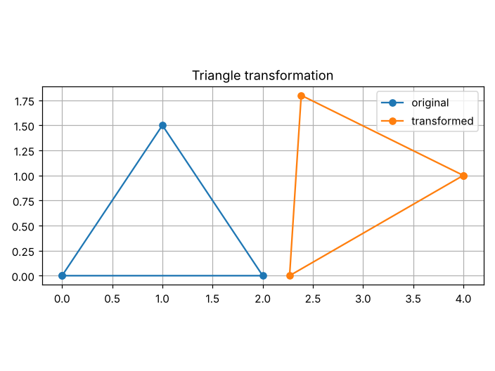

- **Takeaway:** A determinant of $-1$ means the shape was flipped but not resized. Homogeneous coordinates let rotation and translation be combined in one matrix product.

---

## Task 06: Solution of Systems of Linear Equations

### B. Inputs and Mathematical Operations
- **Inputs:** $A = \begin{bmatrix}4 & 2\\ 8 & 12\end{bmatrix}$ (CPU and memory per server type) and $b = [20, 72]^T$ (observed totals).
- **Math operations:**
  - Solve $Ax = b$ with `np.linalg.solve()` (LU with partial pivoting).
  - Residual $r = b - Ax$ and its norm $\|r\|_2$.

### C. Parameter Variation Experiment
- **What I changed:** (a) totals to $[30, 100]$; (b) a nearly singular matrix $\begin{bmatrix}4 & 2\\ 8 & 4.0001\end{bmatrix}$.
- **What happened:**
  - (a) solution became $(5, 5)$.
  - (b) condition number rose from `6.98` to about `250,000`; changing $b_2$ from `40` to `40.01` moved the answer from $(5, 0)$ to $(-45, 100)$.
- **Why it changed:** When the rows are almost parallel, the matrix is ill-conditioned and tiny changes in $b$ are magnified enormously.

### D. Output Interpretation
- The system has 3 Type A and 4 Type B servers, and the residual norm is `0.0`.

### E. Real-World Adaptation: Circuit Mesh Currents
- **Script Location:** `adaptations/Task_06_adapted.py`
- **Real-world Problem:** Find the currents in three coupled loops of a resistor network.
- **Assumptions:** Kirchhoff's voltage law, resistance matrix $R = \begin{bmatrix}10 & -4 & 0\\ -4 & 12 & -5\\ 0 & -5 & 9\end{bmatrix}\,\Omega$, source voltages $[12, 0, -6]\,\text{V}$.
- **Results & Findings:**
  - Currents $I = [1.277,\ 0.192,\ -0.560]\,\text{A}$; residual $\approx 10^{-15}$.
- **Takeaway:** The negative sign means loop 3 carries current opposite to the direction I assumed.

---

## Task 07: Gaussian Elimination and LU Decomposition

### B. Inputs and Mathematical Operations
- **Inputs:** A $3 \times 3$ matrix $A$ and three measurement vectors $b_1, b_2, b_3$.
- **Math operations:**
  - Factor once: $PA = LU$ (`lu_factor`).
  - For each $b$: solve $Ly = Pb$, then $Ux = y$ (`lu_solve`).
  - Factorization costs $O(n^3)$; every extra right-hand side costs only $O(n^2)$.

### C. Parameter Variation Experiment
- **What I changed:** A $300 \times 300$ matrix with 500 different right-hand sides.
- **What happened:** Repeated `np.linalg.solve`: `0.413 s`. LU once and reuse: `0.066 s` (about **$6.3\times$** faster).
- **Why it changed:** The expensive elimination is done once; each new vector only needs two triangular solves.

### D. Output Interpretation
- Set 1 gave $x = (5, 5, 5)$, identical to the direct solver. Residual norms were about $10^{-15}$, i.e. numerically exact.

### E. Real-World Adaptation: Leontief Input-Output Economy
- **Script Location:** `adaptations/Task_07_adapted.py`
- **Real-world Problem:** Total production each sector must make to meet different consumer demands when sectors use each other's output.
- **Assumptions:** 3 sectors, technology matrix $T$, solve $(I - T)x = d$ with the same matrix for three demand scenarios.
- **Results & Findings:**
  - Base demand `[100, 80, 60]` $\rightarrow$ output `[203.74, 160.75, 147.66]`.
  - +20% in sector 1 $\rightarrow$ `[231.78, 166.36, 155.14]`.
  - Recession `[80, 60, 40]` $\rightarrow$ `[158.13, 119.63, 106.17]`.
- **Takeaway:** More demand in one sector increases output in all sectors, and LU factorization lets the same economy be re-solved quickly for each scenario.

---

## Task 08: Iterative Methods for Linear Systems

### B. Inputs and Mathematical Operations
- **Inputs:** A $5 \times 5$ tridiagonal matrix, boundary vector $b = [100, 0, 0, 0, 20]^T$, tolerance $10^{-8}$.
- **Math operations:**
  - **Jacobi:** $x^{(k+1)} = D^{-1}\left(b - (L+U)x^{(k)}\right)$.
  - **Gauss-Seidel:** uses the newest values immediately inside the same sweep.
  - Stop when $\|x^{(k+1)} - x^{(k)}\|_\infty < \text{tol}$.

### C. Parameter Variation Experiment
- **What I changed:** The tolerance ($10^{-3}$ and $10^{-12}$) and the grid size (20 nodes).
- **What happened:**

| Case | Jacobi iterations | Gauss-Seidel iterations |
|---|---|---|
| tol $10^{-8}$, 5 nodes (original) | 150 | 75 |
| tol $10^{-3}$ | 70 | 35 |
| tol $10^{-12}$ | 214 | 107 |
| 20 nodes, tol $10^{-8}$ | 1672 | 842 |

- **Why it changed:** Convergence is geometric, controlled by the spectral radius of the iteration matrix. Tighter tolerances need more steps, bigger grids converge more slowly, and Gauss-Seidel (spectral radius about $\rho_J^2$) needs about half the steps of Jacobi.

### D. Output & Graph Interpretation
- **Terminal output:** Both methods match the direct solution $[86.67, 73.33, 60.00, 46.67, 33.33]^\circ\text{C}$ - a straight temperature drop from the hot end to the cold end.
- **Semilog plot:** The error falls along a straight line (geometric decay). Gauss-Seidel's line is steeper.

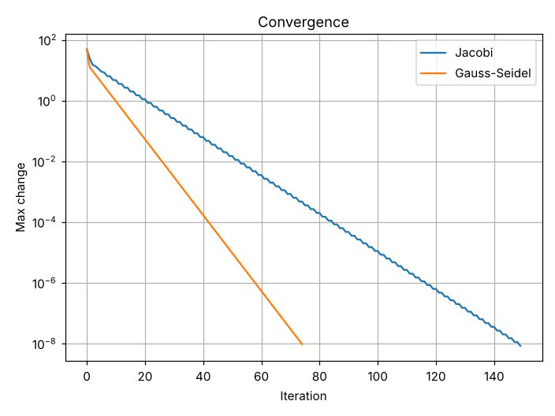

### E. Real-World Adaptation: Heated Metal Rod
- **Script Location:** `adaptations/Task_08_adapted.py`
- **Real-world Problem:** Steady-state temperature at 10 interior points of a rod held at $0^\circ\text{C}$ at one end and $80^\circ\text{C}$ at the other.
- **Assumptions:** 1D steady conduction, no heat source.
- **Results & Findings:**
  - Temperatures: `7.27, 14.55, 21.82, ..., 72.73` $^\circ\text{C}$ after **244** Gauss-Seidel iterations.
  - This is exactly the linear profile expected from theory.
- **Takeaway:** Iterative solvers need only a few values per row, which is why they suit very large sparse systems.

---

## Task 09: Eigenvalues and Eigenvectors

### B. Inputs and Mathematical Operations
- **Inputs:** A symmetric $4 \times 4$ adjacency matrix for nodes A, B, C, D.
- **Math operations:**
  - Solve $Av = \lambda v$ with `np.linalg.eig()`.
  - Pick the dominant eigenvalue (`np.argmax`) and normalize its eigenvector so $\sum v_i = 1$ (eigenvector centrality).
  - Check $\|Av - \lambda v\|_2 \approx 0$.

### C. Parameter Variation Experiment
- **What I changed:** (a) added the link A-D; (b) removed the links B-A and B-D.
- **What happened:**
  - (a) dominant eigenvalue `2.5616` $\rightarrow$ `3.0000`; all scores `0.25`.
  - (b) node C became the most important (`0.366`), others `0.211`.
- **Why it changed:** Eigenvector centrality rewards nodes connected to well-connected nodes. In (a) every node has identical connections, so the scores are equal.

### D. Output Interpretation
- Original network: B and C scored **0.2808**, A and D scored **0.2192**, since B and C each have three neighbors.
- The verification error was about $10^{-15}$.

### E. Real-World Adaptation: PCA of Exam Scores
- **Script Location:** `adaptations/Task_09_adapted.py`
- **Real-world Problem:** Reduce two correlated exam scores (Maths, Physics) of 50 students to fewer dimensions.
- **Assumptions:** $\text{Physics} \approx 0.8 \times \text{Maths} + \text{random noise}$; principal components are eigenvectors of the covariance matrix.
- **Results & Findings:**
  - Eigenvalues `15.07` and `312.17`.
  - The first component explains **95.4%** of the variance.
- **Takeaway:** Both subjects measure largely one underlying ability, so the data can be compressed from 2 variables to 1.

---

## Task 10: Root Finding: Bisection and Fixed-Point Methods

### B. Inputs and Mathematical Operations
- **Inputs:** $f(T) = T - 25 - 10e^{-T/20}$, bracket $[20, 40]$, $g(T) = 25 + 10e^{-T/20}$, tolerance $10^{-10}$.
- **Math operations:**
  - **Bisection:** needs $f(a) \cdot f(b) < 0$; repeatedly halves the interval.
  - **Fixed-point:** iterate $T_{k+1} = g(T_k)$; converges when $|g'(T)| < 1$ (here $|g'| \approx 0.13$).

### C. Parameter Variation Experiment
- **What I changed:** Ambient temperature $25 \rightarrow 35$ with amplitude $10 \rightarrow 20$, and an invalid bracket $[30, 40]$.
- **What happened:**
  - New equilibrium $37.992^\circ\text{C}$.
  - Bracket $[30, 40]$ raised `ValueError: f(a) and f(b) must have different signs`.
- **Why it changed:** The heat-balance constants move the crossing point. Bisection only works when the function changes sign inside the bracket.

### D. Output & Graph Interpretation
- **Terminal output:** Both methods give $27.525211^\circ\text{C}$. Bisection took 38 iterations and fixed-point only **13**.
- **Graph:** $f(T)$ crosses zero at $T \approx 27.53^\circ\text{C}$, where heat gain equals heat loss.

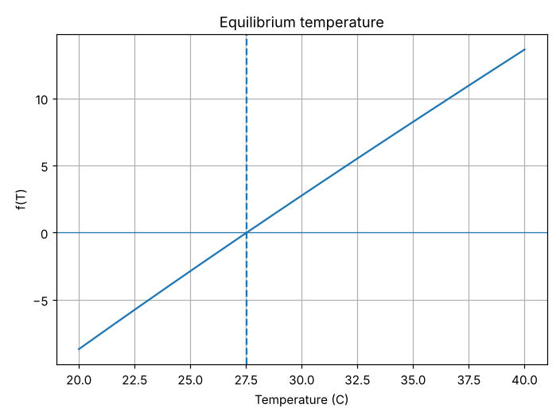

### E. Real-World Adaptation: Break-Even Quantity
- **Script Location:** `adaptations/Task_10_adapted.py`
- **Real-world Problem:** Find the sales volume where profit becomes zero.
- **Assumptions:** Price \$50; fixed cost \$2000; variable cost per unit $20 + 0.01q$.
  $$\text{profit}(q) = 50q - (2000 + 20q + 0.01q^2) = 0$$
- **Results & Findings:**
  - Break-even at $q = 68.22$ units and again at $q = 2931.78$ units (brackets $[1, 200]$ and $[200, 3000]$).

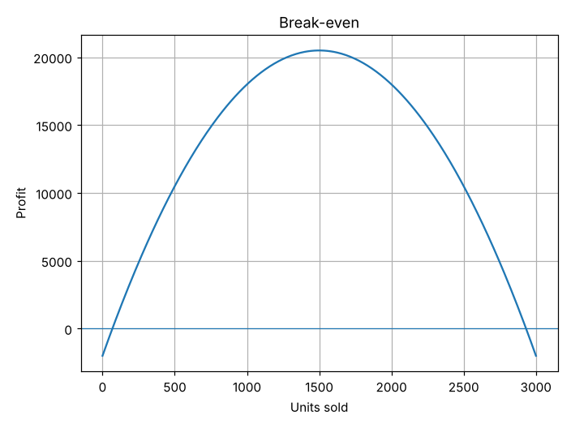

- **Takeaway:** The business makes a profit only between roughly 69 and 2931 units; at high volume rising unit cost wipes out the profit.

---

## Task 11: Root Finding: Newton-Raphson and Secant Methods

### B. Inputs and Mathematical Operations
- **Inputs:** Cash flows $C = [-10000, 3000, 3500, 4000, 2500]$, Newton start $x_0 = 0.10$, secant starts $0.05$ and $0.20$.
- **Math operations:**
  - **Newton-Raphson:** $x_{n+1} = x_n - \frac{f(x_n)}{f'(x_n)}$ with $f(r) = \sum_t \frac{C_t}{(1+r)^t}$.
  - **Secant:** replaces $f'$ with the slope through two recent points.

### C. Parameter Variation Experiment
- **What I changed:** (a) investment $10000 \rightarrow 12000$; (b) Newton start $x_0 = 0.90$.
- **What happened:**
  - (a) IRR dropped from `11.54%` to `3.33%`.
  - (b) Newton converged in 11 iterations to a meaningless root `-154.41%`.
- **Why it changed:** A higher investment lowers the return. Newton's method is only locally reliable: a poor start can reach another root of the polynomial, here a rate below $-100\%$ which has no financial meaning.

### D. Output Interpretation
- **IRR = 11.542461%** from both methods (Newton: 4 iterations, secant: 7). It is the discount rate at which the net present value is zero.

### E. Real-World Adaptation: Loan Interest Rate
- **Script Location:** `adaptations/Task_11_adapted.py`
- **Real-world Problem:** Find the true interest rate of a loan from its repayment schedule.
- **Assumptions:** Borrow 5000 and repay 450 per month for 12 months. Solve $5000 - \sum_{t=1}^{12}\frac{450}{(1+r)^t} = 0$ with the secant method.
- **Results & Findings:**
  - Monthly rate **1.204%**, nominal annual **14.45%**, effective annual **15.45%**.
  - Interest paid: 400.
- **Takeaway:** Because of monthly compounding, the true yearly cost is higher than the nominal rate.

---

## Task 12: Polynomial and Nonlinear Equation Solving

### B. Inputs and Mathematical Operations
- **Inputs:** The system $F(x, y) = [x^2 + y^2 - 4,\ y - (x^2 - 1)]^T$ with initial guesses $[1, 1]$ and $[-1, 1]$.
- **Math operations:**
  - `scipy.optimize.root` (hybrid Powell/MINPACK), which solves $J(z_k)\Delta z_k = -F(z_k)$ iteratively.
  - Check that the residual vector is close to zero.

### C. Parameter Variation Experiment
- **What I changed:** Circle radius $2 \rightarrow 1$, then to $0.5$.
- **What happened:**
  - $R = 1$: three intersections, $(\pm 1, 0)$ and $(0, -1)$, depending on the start.
  - $R = 0.5$: `converged=False`, residual about $0.25$.
- **Why it changed:** Changing the radius changes how many times the curves cross. With $R = 0.5$ they do not cross, so no solution exists.

### D. Output Interpretation
- For $R = 2$ the solver returned $(\pm 1.5175,\ 1.3028)$ with residuals about $0$. The sign of $x$ follows the starting guess because the system is symmetric about the y-axis.

### E. Real-World Adaptation: Projectile Kinematics
- **Script Location:** `adaptations/Task_12_adapted.py`
- **Real-world Problem:** When is a thrown ball at a given height?
- **Assumptions:** $h(t) = 2 + 20t - 4.9t^2$ metres. Solve $h(t) = 10$ with `np.roots`.
- **Results & Findings:**
  - $t = 0.45$ s (rising) and $t = 3.63$ s (falling).
  - Ground contact at $t = 4.18$ s (the negative root $-0.10$ s is not physical).
- **Takeaway:** A quadratic has two roots; choose the one that makes physical sense.

---

## Task 13: Interpolation

### B. Inputs and Mathematical Operations
- **Inputs:** Hourly times $t = 8, \dots, 14$ and temperatures $18.0, \dots, 25.0^\circ\text{C}$.
- **Math operations:**
  - **Linear:** $y(x) = y_i + \frac{y_{i+1} - y_i}{x_{i+1} - x_i}(x - x_i)$.
  - **Cubic spline:** piecewise cubics with continuous value, first derivative, and second derivative at the knots.

### C. Parameter Variation Experiment
- **What I changed:** Asked for 13:30 and for 15:00, which is outside the data.
- **What happened:**
  - 13:30: linear $25.25^\circ\text{C}$, cubic $25.41^\circ\text{C}$.
  - 15:00: the linear interpolator raised an out-of-bounds `ValueError`; the cubic spline extrapolated to $22.94^\circ\text{C}$.
- **Why it changed:** Interpolation is only reliable between measured points. Extrapolating a polynomial is unreliable.

### D. Output & Graph Interpretation
- At 10:30 linear gives **$23.25^\circ\text{C}$** and cubic **$23.36^\circ\text{C}$**.
- The spline is smooth and follows the flattening near the afternoon peak; the linear curve has corners at each measurement.

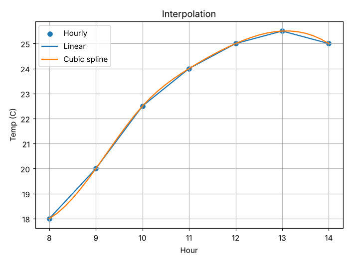

### E. Real-World Adaptation: Missing Air-Quality Readings
- **Script Location:** `adaptations/Task_13_adapted.py`
- **Real-world Problem:** An air-quality sensor lost its PM2.5 readings at 11:00 and 12:00.
- **Assumptions:** Concentration changes smoothly; the remaining 6 hourly values are correct.
- **Results & Findings:**
  - 11:00 $\rightarrow$ `46.3` (linear) / `47.8` (cubic) $\mu\text{g/m}^3$.
  - 12:00 $\rightarrow$ `50.7` (linear) / `53.1` (cubic) $\mu\text{g/m}^3$.
- **Takeaway:** Both methods give sensible gap fillers; the spline allows for curvature and gives slightly higher estimates.

---

## Task 14: Curve Fitting and Approximation

### B. Inputs and Mathematical Operations
- **Inputs:** Users $x = [50, \dots, 350]$ and response times $y = [82, \dots, 305]$ ms.
- **Math operations:**
  - Least squares with `curve_fit`: $\min_{a,b,c}\sum_i (y_i - f(x_i; a, b, c))^2$ for $f = ax^2 + bx + c$.
  - $\text{RMSE} = \sqrt{\frac{1}{N}\sum (y_i - \hat{y}_i)^2}$.

### C. Parameter Variation Experiment
- **What I changed:** Used a linear and a cubic model instead of the quadratic, and added one outlier (400 ms at 250 users).
- **What happened:**
  - Linear RMSE `18.83 ms`; quadratic `1.55 ms`; cubic `0.14 ms`.
  - With the outlier, the 400-user forecast moved from `377.9 ms` to `347.1 ms`.
- **Why it changed:** A line cannot follow curved data (model bias). A cubic follows 7 points almost exactly but risks overfitting. Least squares is sensitive to outliers.

### D. Output & Graph Interpretation
- The fit is $y = 0.002167x^2 - 0.1345x + 85.00$ with $\text{RMSE} \approx 1.55$ ms.
- At 400 users the model predicts **377.9 ms**; response time grows faster than linearly with load.

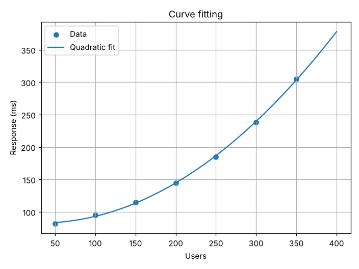

### E. Real-World Adaptation: Exponential Growth
- **Script Location:** `adaptations/Task_14_adapted.py`
- **Real-world Problem:** Estimate the growth rate of a bacterial culture (or user base) from hourly counts.
- **Assumptions:** $y = Ae^{rt}$ with counts from 100 to 770 over 8 hours.
- **Results & Findings:**
  - $A = 100.0$, $r = 0.2919$ per hour, doubling time $\ln 2 / r = 2.37$ h.
  - Forecast at $t = 10$ h: about **1853**.
- **Takeaway:** The fitted parameter has a direct meaning (here the doubling time), which makes curve fitting useful for forecasting.

---

## Task 15: Numerical Differentiation

### B. Inputs and Mathematical Operations
- **Inputs:** Times $t = 0, \dots, 6$ s and GPS positions $x = [0.0, 4.8, 10.2, 16.1, 22.7, 30.0, 38.0]$ m.
- **Math operations:**
  - **Forward** difference at the start: $\frac{f(x+h) - f(x)}{h}$, error $O(h)$.
  - **Central** difference inside: $\frac{f(x+h) - f(x-h)}{2h}$, error $O(h^2)$.
  - **Backward** difference at the end.

### C. Parameter Variation Experiment
- **What I changed:** The step size $h$ for $f = \sin x$ at $x = 1$ (exact $\cos 1 = 0.54030231$).
- **What happened:**

| $h$ | Forward error | Central error |
|---|---|---|
| $10^{-1}$ | $4.3 \times 10^{-2}$ | $9.0 \times 10^{-4}$ |
| $10^{-3}$ | $4.2 \times 10^{-4}$ | $9.0 \times 10^{-8}$ |
| $10^{-6}$ | $4.2 \times 10^{-7}$ | $2.8 \times 10^{-11}$ |
| $10^{-14}$ | $3.7 \times 10^{-3}$ | $3.7 \times 10^{-3}$ |

- **Why it changed:** Truncation error shrinks with $h$ (faster for central differences), but when $h$ becomes too small, round-off error from subtracting nearly equal numbers takes over and the error rises again.

### D. Output & Graph Interpretation
- Speed rises steadily from **4.80 m/s** to **8.00 m/s**, so the vehicle is accelerating.

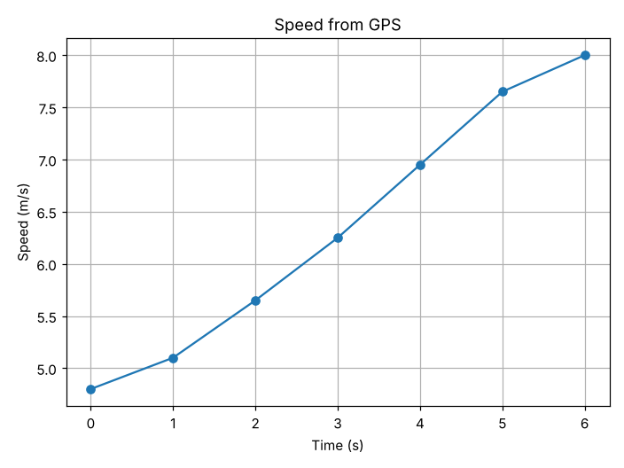

### E. Real-World Adaptation: Acceleration from Velocity Readings
- **Script Location:** `adaptations/Task_15_adapted.py`
- **Real-world Problem:** Estimate the acceleration of a car from velocity readings at 1 s intervals.
- **Assumptions:** Velocities `[0, 3.1, 6.5, 10.4, 14.0, 17.2]` m/s; `np.gradient` (central differences inside, one-sided at the ends).
- **Results & Findings:**
  - Acceleration `[3.10, 3.25, 3.65, 3.75, 3.40, 3.20]` $\text{m/s}^2$, mean **3.39 $\text{m/s}^2$**.
- **Takeaway:** The acceleration is strong and nearly constant. Differentiating noisy data amplifies the noise, so measurements need to be accurate.

---

## Task 16: Numerical Integration

### B. Inputs and Mathematical Operations
- **Inputs:** Times $t = [0, 2, \dots, 12]$ h and power $P = [0.8, 1.0, 1.4, 1.8, 1.6, 1.2, 0.9]$ kW.
- **Math operations:**
  - **Trapezoidal rule:** $\sum \frac{f(x_i) + f(x_{i+1})}{2}\Delta x_i$, error $O(h^2)$.
  - **Simpson's rule:** parabolas over pairs of intervals, error $O(h^4)$.

### C. Parameter Variation Experiment
- **What I changed:** The 6-hour peak from `1.8` to `3.0` kW; and the number of sample points for $\int_0^\pi \sin x\,dx = 2$.
- **What happened:**
  - Energy rose from `15.7 / 15.8` kWh to `18.1 / 19.0` kWh (trapezoid / Simpson).
  - With 33 points the error was $1.6 \times 10^{-3}$ (trapezoid) vs $1.0 \times 10^{-6}$ (Simpson).
- **Why it changed:** Energy is the area under the power curve, so a higher peak adds area. Simpson's higher-order error makes it much more accurate on smooth data.

### D. Output Interpretation
- The day's energy was **15.700 kWh** (trapezoid) and **15.800 kWh** (Simpson); they differ by only 0.1 kWh.

### E. Real-World Adaptation: Total Water Volume from a Flow Meter
- **Script Location:** `adaptations/Task_16_adapted.py`
- **Real-world Problem:** Estimate the volume of water pumped from a flow meter reading in L/s every 10 s.
- **Assumptions:** 7 readings from 0 to 60 s: `[0, 2.5, 4.0, 4.8, 4.2, 2.0, 0.5]` L/s.
- **Results & Findings:**
  - Volume **177.5 L** (trapezoid) and **180.3 L** (Simpson).
- **Takeaway:** Integrating a rate over time gives the accumulated quantity (energy, distance, volume).

---

## Task 17: Ordinary Differential Equations - Euler Method

### B. Inputs and Mathematical Operations
- **Inputs:** $T_0 = 90^\circ\text{C}$, $T_{\text{ambient}} = 25^\circ\text{C}$, $k = 0.12\ \text{min}^{-1}$, 30 min, $h = 1$ min.
- **Math operations:**
  - Newton's law of cooling $\frac{dT}{dt} = -k(T - T_{\text{ambient}})$.
  - Euler update $T_{n+1} = T_n + h\left(-k(T_n - T_{\text{ambient}})\right)$ (global error $O(h)$).
  - Exact solution $T(t) = T_{\text{ambient}} + (T_0 - T_{\text{ambient}})e^{-kt}$ for validation.

### C. Parameter Variation Experiment
- **What I changed:** The step size $h$ (5, 2, 1, 0.5, 0.1, 0.01), and an extreme $h = 20$.
- **What happened:**

| $h$ | Error at 30 min |
|---|---|
| 5.0 | 1.5098 |
| 1.0 | 0.3720 |
| 0.1 | 0.0383 |
| 0.01 | 0.0038 |

- With $h = 20$ the values were `90` $\rightarrow$ `-66` $\rightarrow$ `152.4`: unstable.
- **Why it changed:** Euler assumes the slope is constant over a step, so the error is proportional to $h$. When $kh > 2$ the update overshoots so much that it oscillates with growing amplitude.

### D. Output & Graph Interpretation
- After 30 minutes Euler gives **$26.40^\circ\text{C}$** against the exact **$26.78^\circ\text{C}$** (error **$0.372^\circ\text{C}$**).
- The object cools quickly at first, then slowly levels off at $25^\circ\text{C}$; the Euler curve stays below the exact curve.

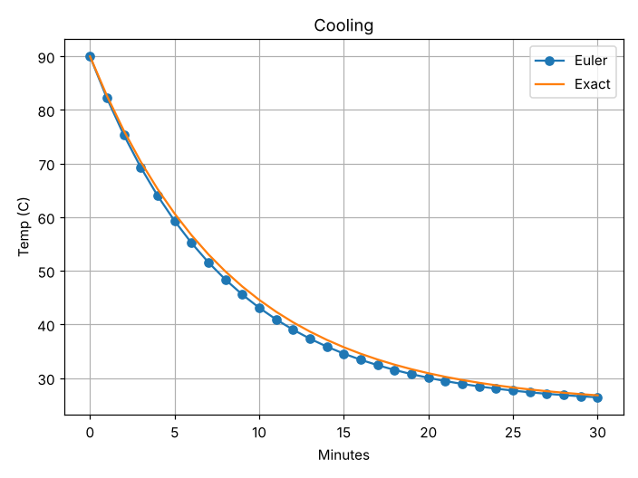

### E. Real-World Adaptation: Logistic Population Growth
- **Script Location:** `adaptations/Task_17_adapted.py`
- **Real-world Problem:** Model a population limited by its environment.
- **Assumptions:** $\frac{dP}{dt} = rP\left(1 - \frac{P}{K}\right)$ with $r = 0.4$, $K = 1000$, $P_0 = 50$, $h = 0.5$.
- **Results & Findings:**
  - $P(10) = 712.8$, $P(20) = 995.0$, $P(30) = 999.9$.

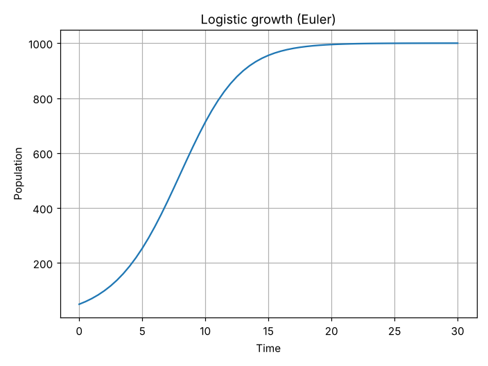

- **Takeaway:** Growth is S-shaped and levels off at the carrying capacity $K$, unlike unlimited exponential growth.

---

## Task 18: Numerical Solution of ODEs Using SciPy

### B. Inputs and Mathematical Operations
- **Inputs:** $V_s = 5$ V, $R = 1000\ \Omega$, $C = 0.001$ F, $V_0 = 0$ V, interval $[0, 5]$ s.
- **Math operations:**
  - $\frac{dV}{dt} = \frac{V_s - V}{RC}$ with time constant $\tau = RC = 1$ s.
  - `solve_ivp` (default adaptive RK45) with `rtol=1e-9`, `atol=1e-11`.
  - Exact curve $V = V_s(1 - e^{-t/RC})$ for validation.

### C. Parameter Variation Experiment
- **What I changed:** (a) $R = 4.7\ \text{k}\Omega$; (b) discharge from $V_0 = 5$ V with $V_s = 0$.
- **What happened:**
  - (a) $\tau = 4.7$ s; $V(1\,\text{s}) = 0.96$ V and $V(5\,\text{s}) = 3.27$ V instead of `4.97` V.
  - (b) $V(1\,\text{s}) = 1.839$ V $= 5/e$.
- **Why it changed:** A larger $R$ increases the time constant, so charging is slower. After one time constant a discharging capacitor holds $1/e \approx 36.8\%$ of its voltage.

### D. Output & Graph Interpretation
- At 5 s (five time constants) the capacitor reached **4.9663 V** (99.3% of the supply). The maximum difference from the exact solution was $9 \times 10^{-10}$ V.

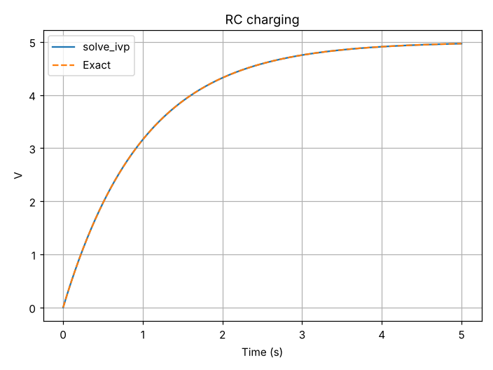

### E. Real-World Adaptation: SIR Epidemic Model
- **Script Location:** `adaptations/Task_18_adapted.py`
- **Real-world Problem:** Predict how an infection spreads in a closed population.
- **Assumptions:** $N = 10000$, 10 initially infected, infection rate $\beta = 0.4$, recovery rate $\gamma = 0.1$ per day, so $R_0 = \beta/\gamma = 4$.
  $$\frac{dS}{dt} = -\beta\frac{SI}{N},\quad \frac{dI}{dt} = \beta\frac{SI}{N} - \gamma I,\quad \frac{dR}{dt} = \gamma I$$
- **Results & Findings:**
  - Infection peak: **4036** people on day **27**.
  - About **9802** people infected over the whole outbreak.

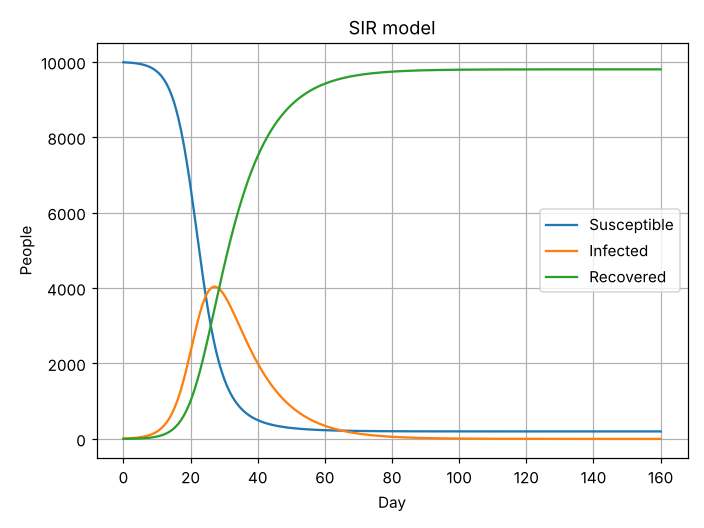

- **Takeaway:** With $R_0 = 4$ almost everyone is eventually infected unless $\beta$ is reduced (distancing) or $\gamma$ increased (treatment).

---

## Task 19: Numerical Optimization

### B. Inputs and Mathematical Operations
- **Inputs:** Costs `[12, 18]`, capacities `[100, 170]`, minimum capacity 1000, bounds $x, y \ge 0$.
- **Math operations:**
  $$\min_{x,y}\ 12x + 18y \quad \text{subject to}\quad 100x + 170y \ge 1000,\ x, y \ge 0$$
  - Solved with `minimize(method="SLSQP")`.
  - An integer search over whole servers gives a practical answer.

### C. Parameter Variation Experiment
- **What I changed:** (a) Type B price $18 \rightarrow 25$; (b) required capacity $1000 \rightarrow 2500$.
- **What happened:**
  - (a) optimum switched to 10 Type A servers (cost `120`).
  - (b) 14.706 Type B units, cost `264.71` (integer solution: 15 B, cost `270`).
- **Why it changed:** The solver buys capacity from the cheaper source per unit: B costs $18/170 = 0.106$ vs A $12/100 = 0.12$. When B's price becomes $25/170 = 0.147$, A becomes cheaper.

### D. Output Interpretation
- Continuous optimum: **0 A and 5.882 B**, cost **105.88**.

